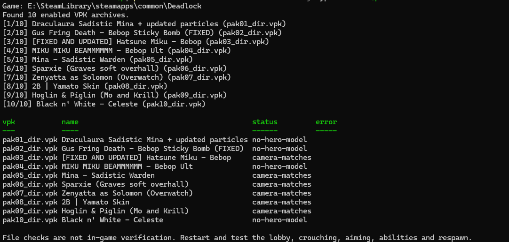

# Deadlock Camera Fix

English | [简体中文](README.zh-CN.md)

Repair known camera compatibility problems in Deadlock skin mods with a single PowerShell script.

`AutoFix.ps1` finds your Steam installation, checks installed mod VPKs against the current game files, 
and repairs recognized outdated camera attachments and lobby camera metadata. Supported repairs are backed up and validated before installation.

This is an unofficial tool, with no affiliation to Valve or skin authors.



## Requirements

- Windows x64 and a local Steam installation of Deadlock.
- Permission to read the game files and write to the mod directory.
- Internet access for the initial runtime/library download. Later runs reuse cached files.
- Enough free space for extracted models, original mod backups and repaired archives.

Windows PowerShell 5.1 can launch the script. When needed, it downloads portable PowerShell 7.6.7 to run the same script on .NET 10. 
Parser libraries are downloaded from GitHub/NuGet with pinned SHA256 checks.

## Quick start

Exit Deadlock and leave Mod Manager idle, then choose either method below.

### Option 1: Download and run manually

1. Download [AutoFix.ps1](https://raw.githubusercontent.com/EatKFCinMc/deadlock_skin_camera_fix/main/AutoFix.ps1)
2. Open PowerShell in the folder containing the file and run:

   ```powershell
   .\AutoFix.ps1
   ```

### Option 2: Download and run with one command

1. Open PowerShell and paste this single line, then run it:

```powershell
& { $p=Join-Path $env:TEMP 'Deadlock-AutoFix.ps1'; Invoke-WebRequest -UseBasicParsing 'https://raw.githubusercontent.com/EatKFCinMc/deadlock_skin_camera_fix/main/AutoFix.ps1' -OutFile $p -ErrorAction Stop; powershell.exe -NoProfile -ExecutionPolicy Bypass -File $p }
```

Running without arguments selects **Repair** mode and may replace supported mod archives. Use **Scan** when you only want an inspection.

After installation, start Deadlock and check the lobby and in-game camera.

If a downloaded script is blocked, first review the file, then unblock it:

```powershell
Unblock-File -LiteralPath .\AutoFix.ps1
```

If execution policy still prevents it from running on a personally managed computer, this command applies RemoteSigned only to that PowerShell process:

```powershell
powershell.exe -NoProfile -ExecutionPolicy RemoteSigned -File .\AutoFix.ps1 -Mode Scan
```

## Usage

### Select a mode

| Mode | Behavior |
| --- | --- |
| `Scan` | Detect and classify camera problems; leave game files unchanged. |
| `Prepare` | Build and validate repair packages with backups; do not install. |
| `Repair` | Prepare supported repairs, then install if Deadlock is closed. This is the default. |
| `Install` | Install packages from a previously saved repair record. Requires `-BatchReport`. |
| `Restore` | Restore original mod archives using a repair record. Requires `-BatchReport`. |

```powershell
# Inspect only.
.\AutoFix.ps1 -Mode Scan

# Prepare packages while keeping installed mods unchanged.
.\AutoFix.ps1 -Mode Prepare

# Prepare and install supported repairs.
.\AutoFix.ps1 -Mode Repair
```

If Deadlock is running, Repair can still prepare packages, but leaves them as `pending-game-exit`. Exit the game before using Install. The script never closes the game for you.

### Specify the game or a mod

If automatic discovery finds no installation or multiple installations, supply the **Deadlock root folder**, not its `game` or `addons` subfolder:

```powershell
.\AutoFix.ps1 -Mode Scan -GamePath 'E:\SteamLibrary\steamapps\common\Deadlock'
```

To work on selected archives, use their current filenames in `game\citadel\addons`:

```powershell
.\AutoFix.ps1 -Mode Scan -Vpk 'pak09_dir.vpk'
.\AutoFix.ps1 -Mode Prepare -Vpk @('pak03_dir.vpk', 'pak09_dir.vpk')
```

These are examples, not fixed hero assignments. Mod Manager can change archive numbers when it installs or reorders mods. Its local manifest/state is used to display mod IDs and names; scanning uses the actual matching VPK files.

### Install or undo a prepared repair

When a package is prepared, the console prints **Repair record:** followed by a `batch-report.json` path. Use that exact path:

```powershell
.\AutoFix.ps1 -Mode Install -BatchReport 'C:\path\to\batch-report.json'
.\AutoFix.ps1 -Mode Restore -BatchReport 'C:\path\to\batch-report.json'
```

Both commands require Deadlock to be closed. Restore returns the archive to its state before that repair, including the skin itself; it does not uninstall the mod. Keep Mod Manager idle during installation or restoration.

If the archive has been updated, moved or renumbered since preparation, the script refuses to overwrite an unexpected file. Scan the current installation rather than editing hashes or forcing an old record onto a different archive.

## How the script runs

1. **Check the environment.** Select a compatible PowerShell/.NET runtime and load the cached parser libraries, downloading verified dependencies if needed.
2. **Locate Deadlock.** Read Steam registry entries and library folders, or use `-GamePath`. Locate the current vanilla archive and the primary addons directory.
3. **List mod archives.** Inspect `pakNN_dir.vpk` files in `game\citadel\addons`. Read Mod Manager information when available for display names.
4. **Match models.** Find supported hero model paths and compare them with current vanilla models. Recognizable sibling backup names can map to their base model; unmatched custom models are skipped.
5. **Classify camera data.** Detect the known old coordinate-axis signature, supported missing-pivot cases, and the narrowly supported lobby binding issue described below. Unfamiliar differences are left for manual review.
6. **Repair working copies.** In Prepare/Repair mode, copy supported camera attachments and lobby metadata into extracted model copies. Apply the checked lobby binding adaptation where applicable.
7. **Validate and repack.** Reopen repaired models, check required camera references, verify preserved non-camera data, back up the original mod and build a repaired VPK. Check CRCs and unchanged archive resources.
8. **Install when allowed.** Prepare stops here. Repair installs only when the game is closed and the target still matches the saved hash. The replacement is staged and its resulting SHA256 is checked.
9. **Display results and clean up.** Scan and runs without prepared repairs leave no saved run logs/reports or extracted model files after normal completion. Prepared repairs retain their backups, packages and Install/Restore records.

Install/Restore use existing packages and records; they do not repeat the model comparison and repair steps.

## Results

| Status | Meaning |
| --- | --- |
| `outdated` | A recognized camera issue was detected; Scan leaves it unchanged. |
| `camera-matches` | Checked gameplay attachments match current vanilla data and no supported lobby repair is required. This is not a complete compatibility test. |
| `prepared` | A validated package is ready, without installation. |
| `pending-game-exit` | Repair prepared a package but the game must close before installation. |
| `installed` / `restored` | Archive replacement and hash verification completed. |
| `unsupported` | Required camera bones are missing and the supported adaptation does not apply; the archive is skipped. |
| `unsupported-archive` | A signed or split mod archive is not rewritten. |
| `review-needed` | Camera data differs without a recognized repair signature. |
| `no-hero-model` / `no-supported-camera-model` | No supported camera model was found, for example in an audio or texture-only recolor package. |
| `failed` | Read the console error. Other archives are handled independently. |

## Storage and backups

Default storage is under `%LOCALAPPDATA%\deadlock-camera-fix`:

| Location | Contents |
| --- | --- |
| `powershell-7.6.7` | Portable runtime, if needed. |
| `tools` | Downloaded model/archive parsing libraries. |
| `repairs\batch-…` | Prepared packages, original backups, extracted model copies and repair records. Created only when a repair is retained after normal completion. |

There is no saved log for every run. The JSON files retained with prepared repairs are the records used to locate packages, verify hashes and restore originals. Keep the entire repair folder while you may need Install or Restore. Existing records from older runs are not automatically deleted.

Advanced parameters:

| Parameter | Purpose |
| --- | --- |
| `-CacheRoot` | Change the base cache directory. |
| `-ToolRoot` | Change the parser library directory. |
| `-OutputRoot` | Change the repair package/backup directory; keep it outside addons. |
| `-ForcePortableRuntime` | Force the portable PowerShell runtime. |

## Repair scope and limits

The tool repairs recognized compatibility issues, not every possible camera problem. It does not change camera preferences, input settings, Mod Manager configuration or mod load order, and does not rebuild missing animation rigs.

For the known `portrait_camera_attach` lobby issue, a missing `attachWorld` can be rebound to `root_motion` only if the vanilla helper is an identity child of that root, both roots have matching bind transforms and unit scales, and the attachment has one weight-1 ordinary bone influence. The repair record lists this in `remappedBones`. Other required missing bones remain unsupported. The same dangling lobby reference can be detected in an earlier patched model whose gameplay pivots already match.

Only the primary addons folder and supported embedded hero models are scanned. Custom mounts, overflow addon folders and arbitrary custom model paths are outside the current scope. Split vanilla archives can be read; signed/split mod archives are not repacked.

File checks, including the lobby bind-pose transform check, do not establish correct animation or in-game behavior. Test after installation. Mod Manager updates/reinstalls can overwrite repairs, and game updates can change compatibility. Rescan when either changes.

The script uses ValveResourceFormat and its parser dependencies. Downloaded third-party libraries retain their own licenses; game and skin assets are not included.
